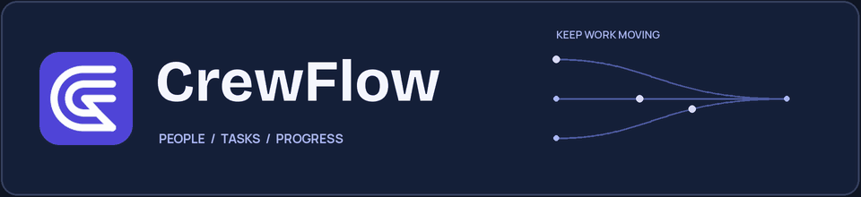
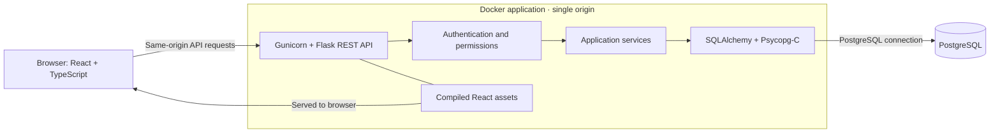

<h1 align="center">
  
</h1>

<p align="center"><strong>Keep teams and work in sync.</strong></p>

<p align="center">
  A workforce and task-management workspace for organizing people, ownership, and progress in one place.
</p>

<p align="center">
  <a href="https://github.com/TheQuantumPanda/CrewFlow/actions/workflows/ci.yml"></a>
  <a href="https://react.dev/"></a>
  <a href="https://www.typescriptlang.org/"></a>
  <a href="https://flask.palletsprojects.com/"></a>
  <a href="https://www.postgresql.org/"></a>
  <a href="LICENSE"></a>
</p>

<p align="center">
  <a href="https://crewflow-a18v.onrender.com/"><strong>Deployment Preview</strong></a> &nbsp;|&nbsp;
  <a href="#quick-start">Quick Start</a> &nbsp;|&nbsp;
  <a href="#architecture-overview">Architecture</a> &nbsp;|&nbsp;
  <a href="#testing-and-verification">Verification</a> &nbsp;|&nbsp;
  <a href="#documentation">Documentation</a>
</p>

> [!NOTE]
> The Render site is a deployed preview. Hosted database migrations and initial Super Admin provisioning have not yet been completed or verified, so it is not a fully verified interactive demo. See [Deployment Preview](#deployment-preview).

---

## Application Showcase

### Screenshots

CrewFlow combines a midnight-navy navigation shell with indigo accents and light and dark workspaces. These are actual browser captures using **temporary fictional API fixtures**; they show presentation, not production records or proof of backend behavior.

|                                                      Overview · light                                                      |                                                     Overview · dark                                                      |
| :------------------------------------------------------------------------------------------------------------------------: | :----------------------------------------------------------------------------------------------------------------------: |
|  |  |
|                                                     **Kanban · light**                                                     |                                                    **Kanban · dark**                                                     |
|          |          |
|                                                    **Task management**                                                     |                                                        **People**                                                        |
|                               |                         |
|                                                      **Departments**                                                       |                                                  **My Tasks · mobile**                                                   |
|                 |   |

[View the complete screenshot gallery](docs/SCREENSHOTS.md), including activity history and role management.

---

## Overview

CrewFlow gives teams a shared view of their people and work. Administrators and managers can organize employees and departments, assign tasks, and follow progress; employees can review and update their assigned work. Access depends on the user's existing role and, where applicable, department.

The project demonstrates a React and TypeScript frontend connected to a Flask API, server-enforced permissions, relational data, audit history, and a Dockerized single-origin deployment.

## Key Features

- **Workforce and departments** — Manage employee records, roles, and departments through the existing permission-dependent interfaces.
- **Role-based workspaces** — Seven roles have different capabilities, with department-scoped management for managers and team leads where supported.
- **Task ownership and progress** — Create and edit tasks, assign eligible employees, and update assignment status and completion percentage.
- **Kanban and task lists** — Follow assignments across five board columns or use the searchable task list with priority filtering and sorting.
- **Dashboards and activity** — View existing summaries and audit events with actor, action, and timestamp information. The activity screen presents summaries rather than a full before/after snapshot viewer.
- **Everyday navigation** — Use the command palette, existing keyboard shortcuts, account settings, and light or dark theme.
- **Administrative console** — Use the separate administrative sign-in and existing people, role, and permission interfaces when authorized.

Board filtering is independent of task-list filtering. Some screens do not have pagination controls; the task-list request fetches at most 200 records. Native board dragging has no separate touch or keyboard implementation.

---

## Architecture Overview

The production image contains the compiled frontend and Flask application. Flask serves the React assets and REST API from the same origin; PostgreSQL is a separate database service.



The backend enforces permissions and department boundaries. Frontend route guards control navigation presentation; they are not the authorization boundary. See the [architecture](docs/ARCHITECTURE.md) and [security](docs/SECURITY.md) documents for details.

## Technology Stack

| Layer              | Technologies                                                    | Purpose                                                                                                                         |
| ------------------ | --------------------------------------------------------------- | ------------------------------------------------------------------------------------------------------------------------------- |
| Frontend           | React 18.3, TypeScript 5.9, React Router 7.18, TanStack Query 5 | Workspace screens, routing, and server state                                                                                    |
| Styling            | CSS design tokens; Manrope, Bricolage Grotesque, JetBrains Mono | CrewFlow visual system and locally bundled fonts                                                                                |
| Frontend build     | Vite 6.4                                                        | Development server and production assets                                                                                        |
| Backend            | Python 3.12, Flask 3.1, Gunicorn 26.2                           | REST API and production application server                                                                                      |
| Data               | SQLAlchemy, Flask-Migrate/Alembic, Psycopg-C 3.3, PostgreSQL    | Relational models, migrations, and PostgreSQL access; PostgreSQL 17 was tested locally, and SQLite and MySQL are also supported |
| Testing            | pytest, pytest-cov, Ruff, Vitest, Testing Library               | Backend and frontend checks                                                                                                     |
| Containerization   | Docker; Node 24 build stage and Python 3.12 runtime             | Multistage image serving the frontend and API                                                                                   |
| Deployment preview | Render Docker Web Service, Neon PostgreSQL                      | Hosted preview and database connection; setup remains incomplete                                                                |

Versions reflect the checked-in manifests, lockfile, and reviewed container configuration.

---

## Quick Start

### Local Setup

Use Python 3.12 and Node.js 24.21.0 with npm. Building Psycopg-C also requires a C compiler, Python headers, libpq development headers, and `pg_config`. The reviewed production image targets `linux/amd64`.

From the repository root, create the isolated backend environment and install the existing development requirements:

```bash
python3.12 tools/ci/python_env.py backend/.venv --wheel output/tools/pip-26.3-py3-none-any.whl --download
source backend/.venv/bin/activate
python -m pip install --build-constraint tools/ci/build-constraints.txt -r backend/requirements-dev.txt
cp backend/.env.example backend/.env
```

Edit `backend/.env` privately. Choose an authorized development database, set a private `SECRET_KEY`, and use `AUTO_BOOTSTRAP=0` unless startup writes are explicitly intended. A new initial administrator requires a private `BOOTSTRAP_ADMIN_PASSWORD`. Keep `.env` out of Git.

> [!WARNING]
> Startup can apply migrations and create baseline records when automatic bootstrap is enabled. The existing demo seed drops and recreates tables. Follow the [controlled database preparation](docs/production-runtime.md#controlled-database-preparation) only for a database you are authorized to change; do not use the seed on preserved or public data. With bootstrap disabled, a fresh database needs the separately controlled migration and provisioning steps before sign-in can work.

Start the backend from `backend/`:

```bash
cd backend
python run.py
```

In a second terminal, start the frontend from the repository root:

```bash
cd web
npm ci
npm run dev
```

Open [http://localhost:5173](http://localhost:5173). Vite proxies `/api` to the local Flask server by default. See [Development](docs/DEVELOPMENT.md) for environment details and other checks.

## Deployment Preview

**[Open the CrewFlow preview](https://crewflow-a18v.onrender.com/)**

CrewFlow has been deployed as a **Render Docker Web Service**, with Neon PostgreSQL connectivity reported by the user. On 2026-11-05, the preview root, `/api/healthz`, and `/api/readyz` returned HTTP 200; readiness reported the configured database reachable. A readiness check does not verify the schema or application accounts. Initial hosted database migrations and Super Admin provisioning have **not yet been completed or verified**, so the URL is a deployed preview rather than a fully verified interactive demo.

The database provider is user-reported; the endpoint checks above do not independently establish the provider. Host-specific permissions, recovery, and release checks still need verification. See [Deployment](DEPLOYMENT.md), [Production Runtime](docs/production-runtime.md), and [Release Assurance](docs/release-assurance.md).

---

## Testing and Verification

| Evidence                   | Scope and recorded result                                                                                                                                                                                                                                                                                                                                                                                                                                                   |
| -------------------------- | --------------------------------------------------------------------------------------------------------------------------------------------------------------------------------------------------------------------------------------------------------------------------------------------------------------------------------------------------------------------------------------------------------------------------------------------------------------------------- |
| Backend suite              | **136 tests passed**, 82% coverage in the recorded local run; ordinary pytest used isolated SQLite and Flask test clients.                                                                                                                                                                                                                                                                                                                                                  |
| Frontend suite             | **82 tests passed** in the recorded local Vitest run; TypeScript and the production build also passed.                                                                                                                                                                                                                                                                                                                                                                      |
| PostgreSQL and permissions | Separate local integration campaigns exercised real PostgreSQL, role-based API authorization, department boundaries, migrations, and restricted database roles.                                                                                                                                                                                                                                                                                                             |
| Browser and HTTPS          | Separate local browser and production-mode HTTPS campaigns covered representative workflows, cookies, CSRF, proxy trust, fonts, and logout behavior.                                                                                                                                                                                                                                                                                                                        |
| GitHub Actions             | [Run #6](https://github.com/TheQuantumPanda/CrewFlow/actions/runs/42067986092) passed normal checks. In the latest observed [run #7](https://github.com/TheQuantumPanda/CrewFlow/actions/runs/42077446064), backend and frontend passed, while the Docker job failed at the vulnerability-regression step; formal release review was skipped. Check the [workflow runs](https://github.com/TheQuantumPanda/CrewFlow/actions/workflows/ci.yml) and badge for current status. |
| Hosted application         | The preview and health/readiness endpoints returned HTTP 200 on 2026-11-05; Neon connectivity is user-reported. Migrations and initial Super Admin provisioning remain unverified and incomplete.                                                                                                                                                                                                                                                                           |

Recorded test counts and local campaigns do not constitute formal production-release approval. [Verification](docs/VERIFICATION.md) records an earlier local snapshot; the hosted run results above supersede its statement that GitHub Actions had not yet run. Residual image findings and owner decisions remain tracked in [Release Assurance](docs/release-assurance.md) and the [security decision register](docs/security-decisions.json).

To run the existing frontend checks from `web/`:

```bash
npm run typecheck
npm run test
npm run build
```

With the isolated development environment active, run backend checks from `backend/`:

```bash
ruff check .
pytest -q --cov=task_management --cov-report=term-missing
```

## Documentation

| Document                                         | Contents                                                      |
| ------------------------------------------------ | ------------------------------------------------------------- |
| [Development](docs/DEVELOPMENT.md)               | Local setup, native prerequisites, and development checks     |
| [Architecture](docs/ARCHITECTURE.md)             | Application layers and request flow                           |
| [API reference](docs/API.md)                     | Existing API endpoints and request examples                   |
| [Security](docs/SECURITY.md)                     | Authentication, permissions, and security architecture        |
| [Screenshots](docs/SCREENSHOTS.md)               | Full fictional-fixture screenshot gallery                     |
| [Verification](docs/VERIFICATION.md)             | Recorded local tests, integration evidence, and limitations   |
| [Deployment](DEPLOYMENT.md)                      | Deployment preparation and operational considerations         |
| [Production runtime](docs/production-runtime.md) | Configuration, database preparation, and native build details |
| [Release assurance](docs/release-assurance.md)   | CI evidence, image scanning, and release review               |

---
