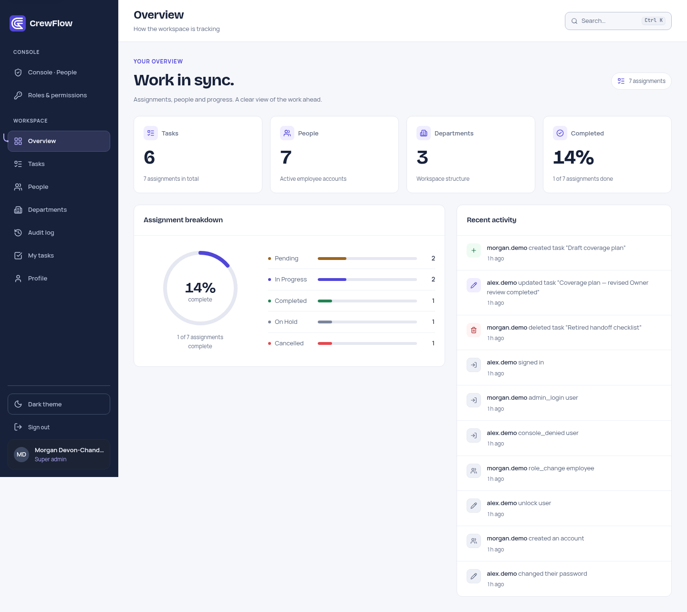
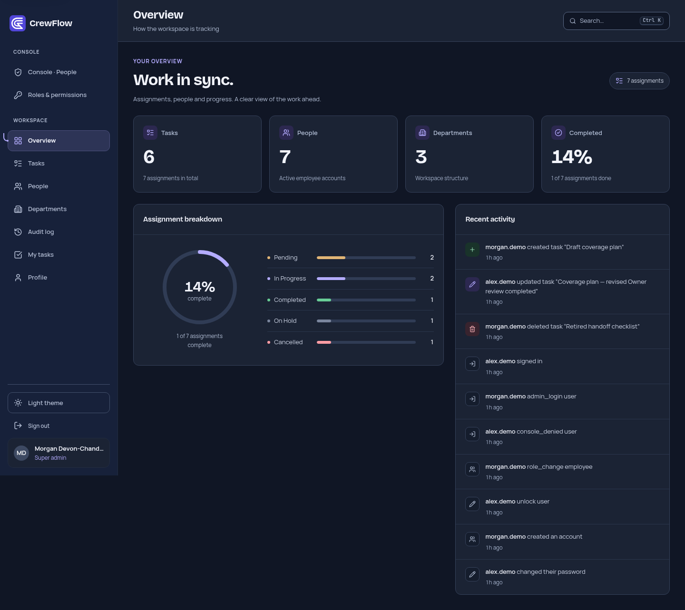
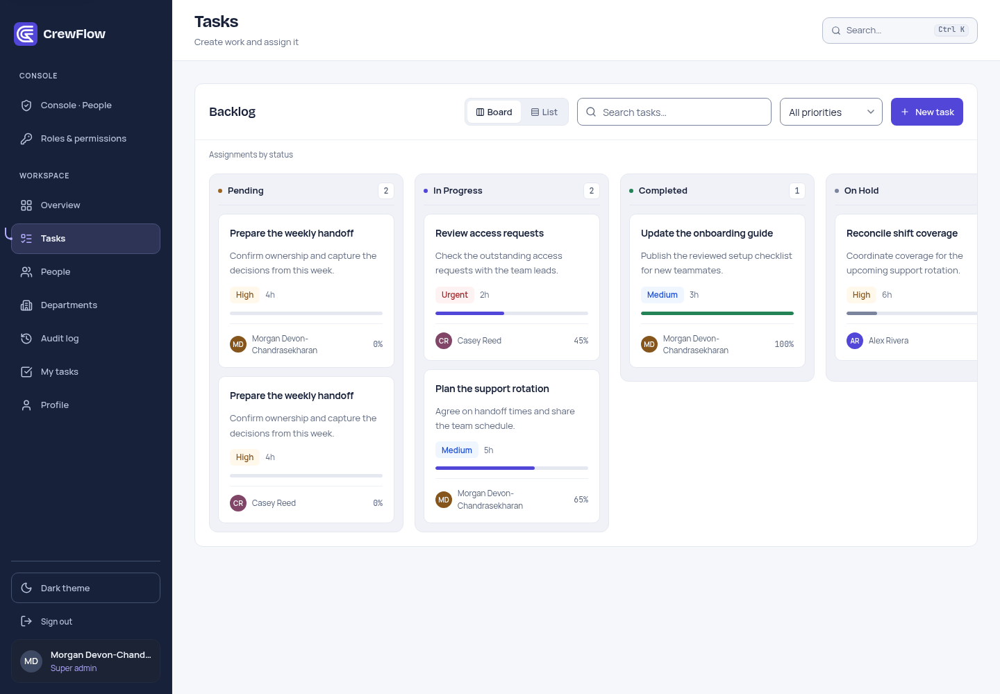
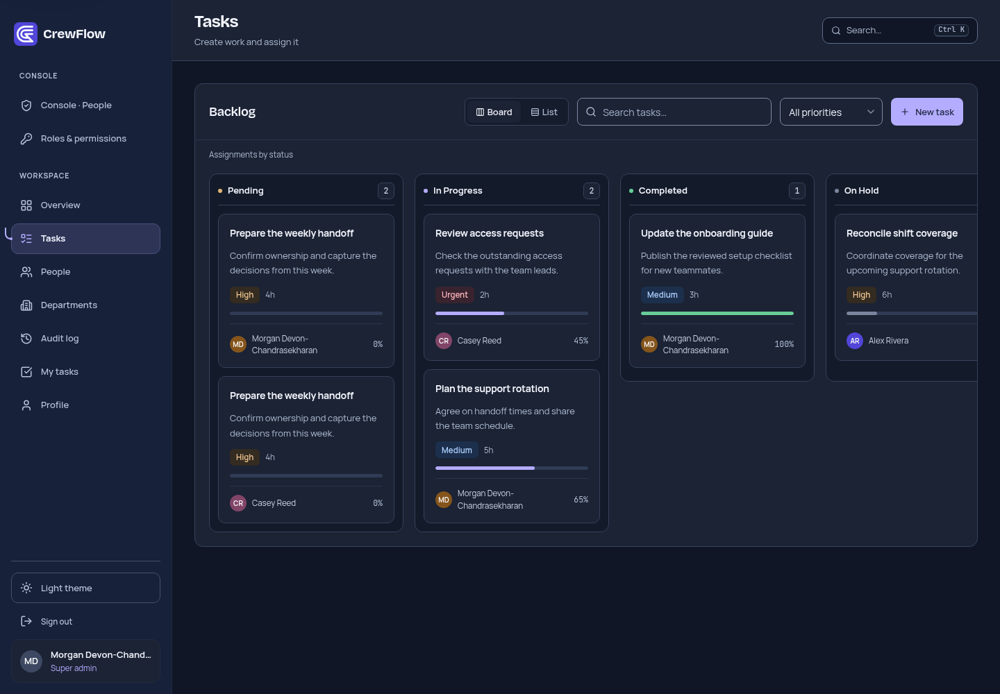
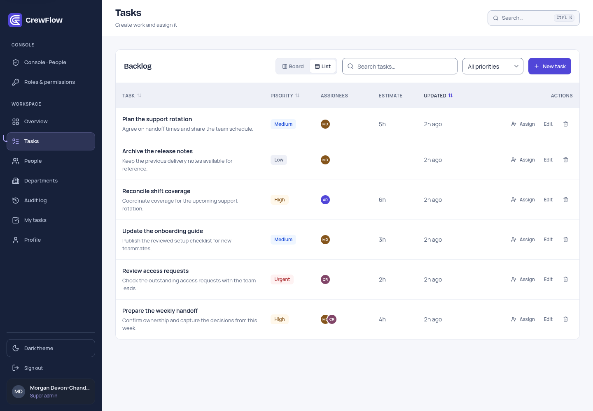
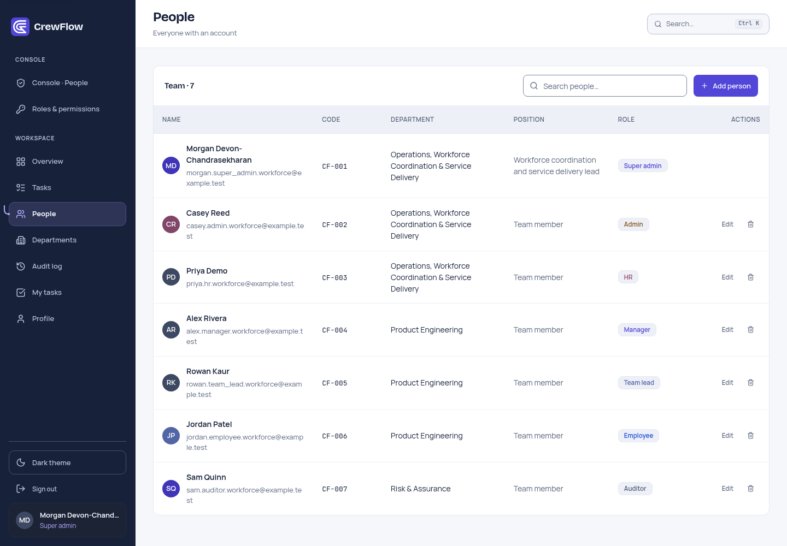
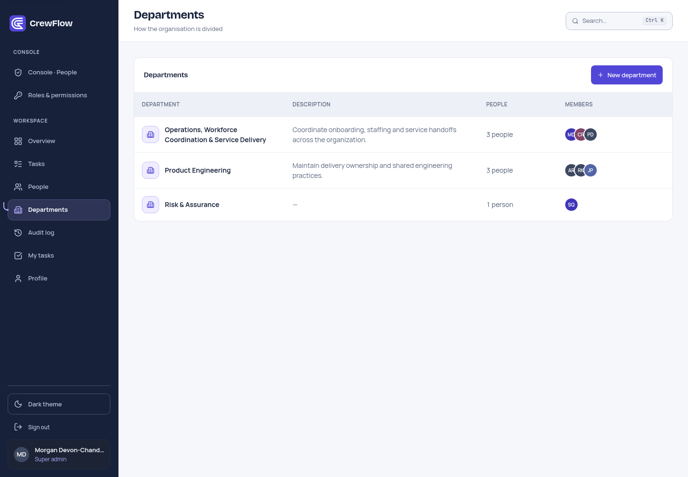
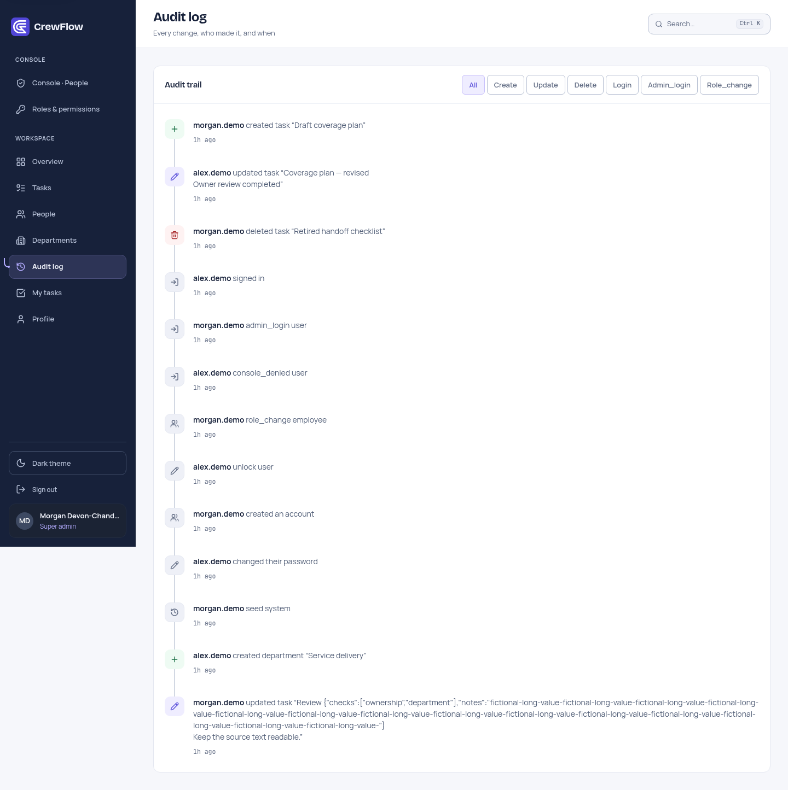
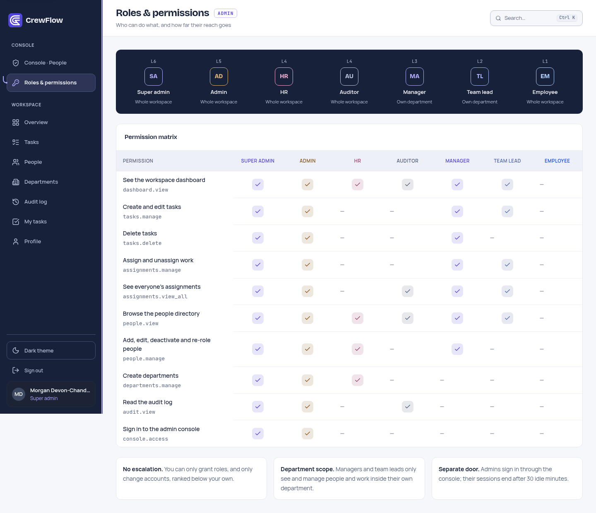
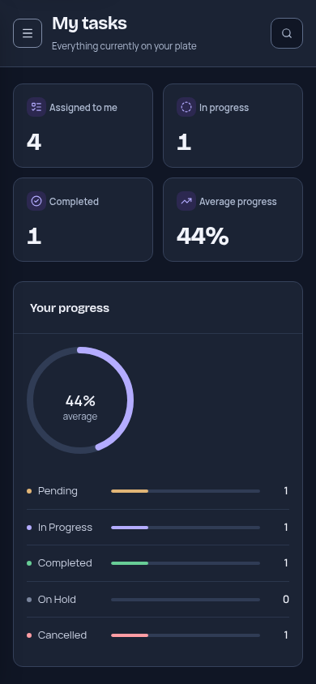

# CrewFlow

**Keep teams and work in sync.**

CrewFlow is a workforce and task-management platform with role-based workspaces, department-scoped management, task ownership and progress tracking. This portfolio customization gives the existing TaskForge application an original connected-path identity, a navy and indigo interface, and consistent light and dark themes while preserving its underlying application architecture.

## Screenshots

These are actual browser captures of the finished interface using **temporary fictional API fixtures**. They demonstrate presentation, not live database contents, backend authorization or persistence. Desktop captures use a 1440 × 1000 viewport; the mobile capture uses 390 × 844. No credentials are shown.

<table>
<tr><td width="50%"><br>Overview · light</td><td width="50%"><br>Overview · dark</td></tr>
<tr><td><br>Kanban · light</td><td><br>Kanban · dark</td></tr>
<tr><td><br>Task list</td><td><br>People</td></tr>
<tr><td><br>Departments</td><td><br>Audit history</td></tr>
<tr><td><br>Roles and permissions</td><td align="center"><br>My Tasks · mobile</td></tr>
</table>

[More screen captures](docs/SCREENSHOTS.md) · [Final verification and readiness report](docs/VERIFICATION.md)

## Features

- Seven existing roles: super admin, admin, HR, manager, team lead, employee and auditor. Capabilities follow the server's permission map.
- Department-scoped people and assignment management for managers and team leads; employees view and update their own assignments.
- Task creation and editing, eligible employee assignment, priority, descriptions, notes, optional estimated hours, and assignment status/progress updates.
- Five-column assignment Kanban with native desktop drag-and-drop, plus a task list with search, priority filtering and sorting by title, priority or update time.
- Overview and My Tasks summaries calculated from the existing API data.
- People and department management, account deactivation/unlocking, confirmed role changes and a read-only permission matrix where permitted.
- Activity history with existing action filters, actor/timestamp information and a connected timeline. Backend audit records contain before/after data; the UI displays existing summaries and selected titles/names, **not a full snapshot viewer**.
- Command palette at **Ctrl/Cmd + K**, existing `g`-then-key navigation shortcuts, theme switching, account details and password updates.
- Separate administrative sign-in with the existing console access restrictions and idle-session policy.

Board filtering is independent of task-list filtering. There is no calendar, due-date management, messaging, advanced analytics, or separate touch/keyboard drag implementation. The task API supports paging, but the current task-list request fetches at most 200 records and the UI has no page controls.

## Technology and architecture

| Layer | Implementation |
| --- | --- |
| Frontend | React 18, TypeScript, Vite 5, React Router 6, TanStack Query 5, Lucide icons |
| Styling | Existing CSS token system; locally bundled Manrope, Bricolage Grotesque and JetBrains Mono |
| Backend | Flask 3, Flask-SQLAlchemy, SQLAlchemy 2, Flask-Migrate/Alembic, Werkzeug password hashing |
| Database | SQLite by default; existing PostgreSQL and MySQL driver support |
| Verification | Vitest, Testing Library, pytest, pytest-cov, Ruff and local Playwright browser inspection |

`web/src/pages` contains route presentations; `layout` and `components` provide navigation, dialogs and shared controls. Typed requests and server state remain in `web/src/api`. Flask routes under `backend/task_management/routes` delegate to services and SQLAlchemy models. Server-side permissions and department predicates enforce access; browser guards only control navigation presentation. Session cookies and the existing CSRF mechanism are retained. Flask can serve the compiled SPA from `web/dist`; development uses Vite's API proxy.

## Local setup

Requirements: **Python 3.11 or 3.12** and **Node.js 20+**. Pass 5 used Python 3.11; the existing CI targets 3.12. Start from this project directory. No external database server is needed for a new, explicitly chosen local SQLite environment.

Create the backend environment:

```bash
cd backend
python -m venv .venv
source .venv/bin/activate
python -m pip install -r requirements-dev.txt
cp .env.example .env
```

On Windows, activate with `.venv\Scripts\Activate.ps1`. Edit the local `.env` before starting: choose a development database and a private `SECRET_KEY`. Never commit this file or point verification at production data.

**Startup can write to the database.** The existing `AUTO_BOOTSTRAP` default applies migrations and creates baseline departments/an initial admin on an empty database. Use that only for an explicitly authorized local database. Set `AUTO_BOOTSTRAP=0` when automatic initialization must be disabled. The `seed` CLI drops and recreates the demo database; it is deliberately excluded from this quick start. Existing accounts are not assumed to exist, and no credentials are published here.

Start the API in the backend terminal:

```bash
python run.py
```

In another terminal, from the project root:

```bash
cd web
npm ci
npm run dev
```

Open `http://localhost:5173`. Vite proxies `/api` to `http://127.0.0.1:5000` by default. Use accounts authorized for your chosen development environment. A newly initialized local database's bootstrap account must be handled privately through the existing bootstrap process; do not include its credential output in screenshots or reports.

To compile the frontend locally:

```bash
cd web
npm run build
```

This produces `web/dist`; it does not deploy the application. [Development details](docs/DEVELOPMENT.md).

## Environment configuration

No environment variables are mandatory for the default development SQLite configuration. `SECRET_KEY` is mandatory in production; database selection and bootstrap behavior should be reviewed before any local startup. Names below are the existing application contracts and retain their internal TaskForge identifiers.

| Variables | Purpose |
| --- | --- |
| `APP_ENV`, `FLASK_ENV` | Configuration selection; development is the default. `FLASK_ENV` also affects the dev runner's debug behavior. |
| `SECRET_KEY` | Session-signing secret; keep private and stable. |
| `DATABASE_URL` | Explicit database URL; takes precedence over `DB_*`. Without it or MySQL settings, SQLite uses `backend/instance/taskforge.db`. |
| `DB_HOST`, `DB_PORT`, `DB_USER`, `DB_PASSWORD`, `DB_NAME` | Existing alternative MySQL configuration. |
| `AUTO_BOOTSTRAP`, `BOOTSTRAP_ADMIN_USERNAME`, `BOOTSTRAP_ADMIN_PASSWORD` | Existing migration/baseline initialization and initial-account settings. |
| `MIN_PASSWORD_LENGTH`, `MAX_FAILED_LOGINS`, `LOCKOUT_MINUTES` | Existing password and lockout policy. |
| `ADMIN_IDLE_MINUTES`, `SESSION_LIFETIME_SECONDS` | Console idle timeout and session lifetime. |
| `PORT` | Flask development runner port. |
| `VITE_API_TARGET` | Vite development proxy target. |
| `VITE_DEMO_MODE` | Optional demonstration-account presentation; disabled unless explicitly enabled. |
| `WEB_CONCURRENCY`, `GUNICORN_THREADS`, `GUNICORN_TIMEOUT`, `LOG_LEVEL` | Existing Gunicorn worker/log settings; no hosting changes were made. |

See [backend/.env.example](backend/.env.example) for the existing template. Do not copy private values into documentation.

## Tests and verification

From `web/`:

```bash
npm run typecheck
npm run test
npm run build
```

From `backend/`, with the development requirements installed:

```bash
ruff check .
pytest -q --cov=task_management --cov-report=term-missing
```

Verification on **2026-11-04**: frontend typecheck/build passed; **27 frontend tests across 3 files passed**; **89 backend tests passed with 77% coverage**; Ruff passed. The backend suite uses fresh **in-memory SQLite** through Flask's test client, not a running server or configured development database. PostgreSQL/MySQL behavior was not exercised.

Final browser review uses fictional API fixtures for representative screens, themes, viewports, error displays and keyboard behavior. Prior management/task workflow checks were also mocked. **Live sign-in, database persistence, cross-department HTTP enforcement, and actual audit persistence remain blocked:** no authorized development configuration, database or test accounts were supplied. No database was initialized, migrated, reset or seeded for this pass.

Existing `npm audit` checks report **9 affected package entries**: 2 critical, 2 high and 5 moderate. The runtime-only audit reports **2 moderate entries**. These counts include transitive/parent package entries and are not distinct exploitable application flaws. Versions were not upgraded; applicability and remediation require separate review. No Python vulnerability scanner is configured, so this pass does not certify Python dependency security.

## Limitations and readiness

**CONDITIONAL** portfolio/publication readiness: visual customization and documentation are complete, but live backend verification and security remediation remain outstanding. The subsequent technical preflight rates the current production configuration **NOT READY for public deployment**, including its vulnerable Gunicorn pin. See the [verification summary](docs/VERIFICATION.md). This is not deployment approval or a security certification.

- The inherited modal return-focus issue reproduced in all 20 final keyboard-probe cycles; shared focus-management behavior was deliberately not changed.
- Native drag-and-drop has no separate touch or keyboard implementation.
- Dense tables and Kanban columns scroll inside their containers on smaller screens.
- Board and list filters are independent; some screens have no pagination controls.
- Audit details remain summaries rather than an expandable full before/after viewer.
- Management request failures now display load-error messages rather than misleading empty states. Missing department-member data is marked unavailable; existing request/retry behavior is unchanged.

[Final evidence, workflow status and remaining limitations](docs/VERIFICATION.md).

## License and attribution

CrewFlow is a frontend portfolio customization of **TaskForge**. The original **MIT License, Copyright (c) 2026 Ayush Yadav**, remains in [LICENSE](LICENSE), including its permission and warranty notices. This presentation does not claim authorship of the original backend or permission system.

The CrewFlow three-path C mark is original SVG geometry. Runtime library and font notices are preserved in [web/public/third-party-notices.txt](web/public/third-party-notices.txt), which is copied into frontend build output. Fonts retain their SIL Open Font License texts; Lucide retains its ISC notice, including the upstream third-party material included in that package's license file.
